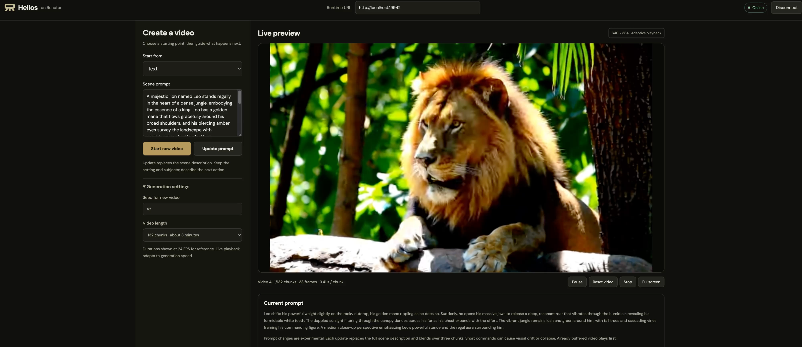

# Helios on Reactor

Stream [Helios-Distilled](https://github.com/PKU-YuanGroup/Helios) from text,
an uploaded image or a short video, powered by [Reactor](https://reactor.inc).
The WorldCrafter-style browser demo lets you start a scene and change its prompt
while generation continues. Helios generates native 33-frame chunks at 640 × 384;
playback adapts to generation speed.



## What the integration adds

- A Reactor Runtime service with a small browser client and typed commands.
- Text-to-video, image-to-video and video continuation with uploaded references.
- Live prompt editing with the native three-chunk embedding transition, keeping
  video history and random state. Updates while paused take effect after Resume.
- Explicit Start, Pause, Resume, Reset, Stop and session-ending Disconnect.

The default is the official Distilled inference schedule: three pyramid stages
with two steps each, doubled for the first chunk, guidance 1.0, BF16 transformer
and text encoder, FP32 VAE, and the original history/first-frame conditioning.
All weights stay on one GPU. There is no offload, quantization or approximate
activation cache. Keyboard camera geometry is not a released Helios input;
use text to describe motion.

Live prompt changes use the upstream experimental, zero-shot interpolation path.
Each update **replaces the full scene description** while keeping video history;
include the setting, subjects and new action instead of sending only a short
command. Quality is not guaranteed: a seed-42 fish scene changed to
`A shark comes` developed severe color saturation and lost scene detail in the
unmodified official pipeline, including with compilation disabled. See the
[upstream interactive-inference caveat](https://github.com/PKU-YuanGroup/Helios/issues/47).

## What you need

Use a Linux host with one NVIDIA B200, Docker, NVIDIA Container Toolkit and the
[Reactor CLI](https://docs.reactor.inc/deploy/platform/installation). The model
manifest targets one B200. The native project reports H100 results; this port's
hardware acceptance is recorded separately below. Allow roughly 75 GiB for the
inference checkpoint, plus the Docker image and
compiler cache. The frontend uses Node.js 22+ and npm.

Run the following commands from this adapter directory (`models/helios` in the
Cookbook, or `reactor` in the Helios repository).

## 1. Install the CLI and build

```sh
curl -fsSL https://reactor.inc/install | bash
reactor version
reactor validate
reactor build
```

The YAML build installs Runtime **3.11.0**, Python 3.12, CUDA 12.8, PyTorch 2.10.0,
Diffusers 0.38.0 and Transformers 5.3.0. It checks out Helios source
`f1a8aadd7c42df29968b9ed73b5c3bc6ae2980c4` once at `/opt/helios`.
Native training and inference files are unchanged.

## 2. Start the model

```sh
reactor run --gpus device=0 --shm-size 2g --port 8090
```

Select a free GPU on a shared host. The first start downloads only the inference
components of `BestWishYSH/Helios-Distilled` at
`b991c0379a018f4de3227d95468237f56066f5bb`, under the manifest's weights directory.
It excludes the ODE teacher. A prepared checkpoint can be reused with:

```sh
reactor run --gpus device=0 --shm-size 2g --port 8090 \
  --weights /absolute/path/to/Helios-Distilled
```

Keep the terminal running. Readiness includes loading all weights and warming
up text, image and video inputs plus continuation chunks. The tested cold compile
and warmup took about **6 minutes 47 seconds**, excluding the checkpoint download.
A persistent compiler cache can reduce later startup work. Check in another terminal:

```sh
curl -fsS http://localhost:8090/health
```

Wait for `"state":"available"`. `Ctrl+C` stops the service. Rebuild after editing
the adapter. An unexpected model failure ends the Runtime loop; restart the
service before reconnecting.

## 3. Open the browser client

In another terminal, from this adapter directory:

```sh
cd demo
npm ci
npm run dev
```

Open the printed URL (normally **http://localhost:5173**). Set Runtime to
**http://localhost:8090**, click **Connect**, choose a starting mode and prompt,
then click **Start video**. No image is selected automatically. File selection
waits for Start. `npm run build && npm run preview` serves the production client.

Start video and Update prompt sit directly below Scene prompt; on phones they
stay in the bottom action bar. Seed and Video length are in **Generation settings**
under the left-hand prompt controls. Image and video modes start with neutral continuation prompts;
each mode keeps its edited prompt while you switch inputs. Selecting another
reference does not overwrite your text.

| Control | Behavior |
| --- | --- |
| Text | Start from the prompt alone. |
| Image + text | PNG/JPEG/WebP, at most 20 MiB and 32 megapixels. |
| Video + text | At most 100 MiB, 33–330 frames, at most 32 megapixels per frame. |
| Start video / Start new video | Start fresh from the form's reference, prompt, seed and length. |
| Update prompt | Replace the full scene description; retain history and blend over three chunks. Experimental quality. |
| Pause / Resume | Hold generation / continue the same history. Buffered frames can still play. |
| Reset video | Restart from the accepted reference, current accepted prompt and seed. |
| Stop | End generation and clear playback, retaining accepted inputs for Reset. |
| Disconnect | End the shared session, free its world state and clear displayed progress. |

Prompt updates are gradual and model adherence is imperfect. The three transition
chunks use the old embedding, a 50/50 blend, then the new embedding; already
buffered frames reflect earlier text. An update received during a transition starts a new
transition from the embedding currently in use. The upstream project describes
interactive generation as experimental and notes weaker image/video conditioning
than text-only generation.

The default is 44 native chunks. After the original final-frame crop this is
1,449 frames, about 60 seconds at the native example's 24 FPS export rate.
Live playback is adaptive, not pinned to 24 FPS. The API allows 1–132 chunks;
the UI also offers 10, 88 and 132. Completion stops generation without silently
starting another video.

### Remote GPUs and SSH

The browser needs both the HTTP service and a working WebRTC media path.
Forwarding HTTP alone does not transport video. Configure an authenticated
TURN/TCP relay reachable by the Runtime and browser, then forward its listener
along with the HTTP and frontend ports. For example, **after configuring TURN
on the GPU host at port 3478**:

```sh
ssh -N -L 8090:127.0.0.1:8090 -L 5173:127.0.0.1:5173 \
  -L 3478:127.0.0.1:3478 your-gpu-host
```

Set Runtime's supported `TURN_SERVERS` configuration to your relay credentials
and address; the relay address advertised to the browser must be reachable
through its tunnel. Keep credentials outside the repository. Host networking
alone does not make an SSH tunnel carry UDP. See
[local testing](https://docs.reactor.inc/deploy/development/local-testing).

## Performance and limitations

The tested configuration uses one B200, Runtime 3.11.0, the default settings
and the documented `reactor build` / `reactor run` image. Weights remain resident;
attention uses the official PyTorch SDPA path (`--disable_flash_attention`),
with `torch.compile` enabled.

| Measurement | Result |
| --- | --- |
| Runtime generation, recording enabled | 16.6 FPS after the first chunk; continuation chunks 1.96–2.01 seconds |
| First Runtime chunk | 3.44 seconds; 15.5 FPS overall for 10 chunks / 329 frames |
| Browser over TURN/TCP | Median 17 FPS after startup; first displayed frame in 3.58 seconds |
| Default uninterrupted video | 44 chunks / 1,449 frames, with two live prompt updates |

Generation FPS uses emitted frames and Runtime step durations; browser FPS is
measured at the WebRTC receiver with client-side recording off. These results
do not establish continuous 24 FPS playback. Sampled GPU memory reached 45.6 GiB;
that excludes cold compilation peaks and is not a minimum-memory requirement.

The adapter preserves the released sampling schedule, RNG ordering, conditioning,
per-chunk decoding and final-frame crop. Fixed-input comparisons against the
unmodified pipeline matched generated latents and decoded RGB exactly for text
(4 chunks / 129 frames), image and video (2 chunks / 65 frames each), before lossy
encoding. A 40-chunk prompt-switch comparison also matched when both paths used
identical precomputed text embeddings. These are scoped comparisons: encoding a
batch of captions and encoding live captions separately can differ numerically.
Matching the native output does not guarantee prompt adherence or visual stability.

Text, image and video inputs, paused prompt updates, joining viewers, refused
uploads, Reset, Stop and Disconnect have been exercised in the browser. Live
prompt transitions remain experimental; use complete scene descriptions and
start a new video if a transition degrades the scene.

## Build your own client

The model exposes `main_video`, silent RGB video. Commands are `start`,
`update_prompt`, `pause`, `resume`, `reset` and `stop`; every command returns
`command_accepted`. Await each command's reply. Subscribe to `state_update` for
shared state and progress. A joining viewer receives the current snapshot.

```sh
curl -fsS http://localhost:8090/schema
python -m reactor_runtime.schema --path . --out /tmp/helios-schema.json
PYTHONPATH=. python -m pytest tests/ -q
```

Tests need Runtime 3.11.0, NumPy, Pillow, PyAV, PyYAML and pytest; they do not need
weights or a GPU. Install pytest separately from the serving requirements.
The browser demo is local-only. A hosted application uses server-side API-key
exchange for a session JWT, plus an `owner/name` model identifier.

`helios_app.py` owns client decisions and forwards one input to
`DistributedRunner`. `helios_model.py` owns the immutable CPU contracts and
rollout identity. `helios_backend.py` owns GPU weights, embeddings and history;
it imports no Runtime code. `helios_assets.py` resolves source/checkpoint paths
before worker startup. `helios_images.py` validates and decodes uploads on CPU.

## Credits and license

[Helios](https://github.com/PKU-YuanGroup/Helios) is released by PKU YuanGroup and
its contributors under Apache-2.0; preserve its model and source license.
This Reactor integration and the adapted WorldCrafter demo layout are by
[Rising0321](https://github.com/Rising0321). See `NOTICE` for attribution.
Feedback and collaboration are welcome at [ruixing@reactor.inc](mailto:ruixing@reactor.inc).
